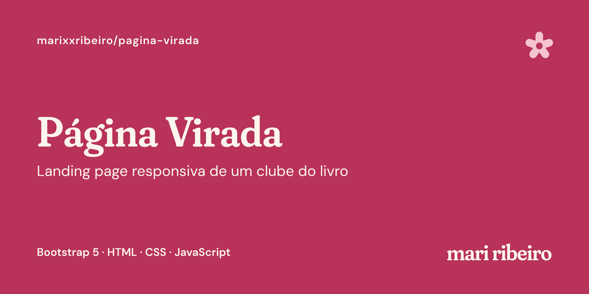

# Página Virada · clube do livro

Landing page responsiva de um clube do livro fictício em Belo Horizonte, feita com **Bootstrap 5**, HTML, CSS e JavaScript.

🔗 **Site no ar:** https://marixxribeiro.github.io/pagina-virada/

> Projeto de estudo do curso de Análise e Desenvolvimento de Sistemas. O clube, o café e os encontros são fictícios.

## Funcionalidades

- Layout responsivo com o grid de 12 colunas do Bootstrap
- Navbar que vira menu ☰ no celular
- Estante de livros gerada por JavaScript a partir de uma lista de dados
- Filtro de livros por gênero
- Modal com os detalhes do livro clicado
- Agenda em tabela e perguntas frequentes em accordion
- Formulário com validação dos campos obrigatórios
- Identidade visual própria: paleta colorida, tipografia Fraunces + DM Sans e rabiscos em SVG
- Capas de livro desenhadas só com CSS, sem imagens

## Tecnologias

HTML5 · CSS3 · Bootstrap 5.3 · JavaScript

## O que aprendi

- Montar layouts responsivos com `container`, `row` e `col`
- Personalizar o Bootstrap com variáveis CSS, sem a aparência padrão
- Gerar HTML a partir de dados com `map()` e template strings
- Filtrar dados com `filter()` e encontrar itens com `find()`
- Usar eventos do JavaScript e do próprio Bootstrap
- Validar formulários com `checkValidity()`
- Posicionar elementos decorativos com `position: absolute` e `z-index`
- Encontrar e corrigir erros com o painel Problems do VS Code e o Console do navegador
- Versionar o projeto com Git e publicar com GitHub Pages

## Como rodar

Não precisa instalar nada: baixe o projeto e abra o `index.html` no navegador.

---

Feito por **Mari Ribeiro** · [LinkedIn](https://linkedin.com/in/mari-ribeiro) · [Site](https://www.mariribeiro.com.br)

